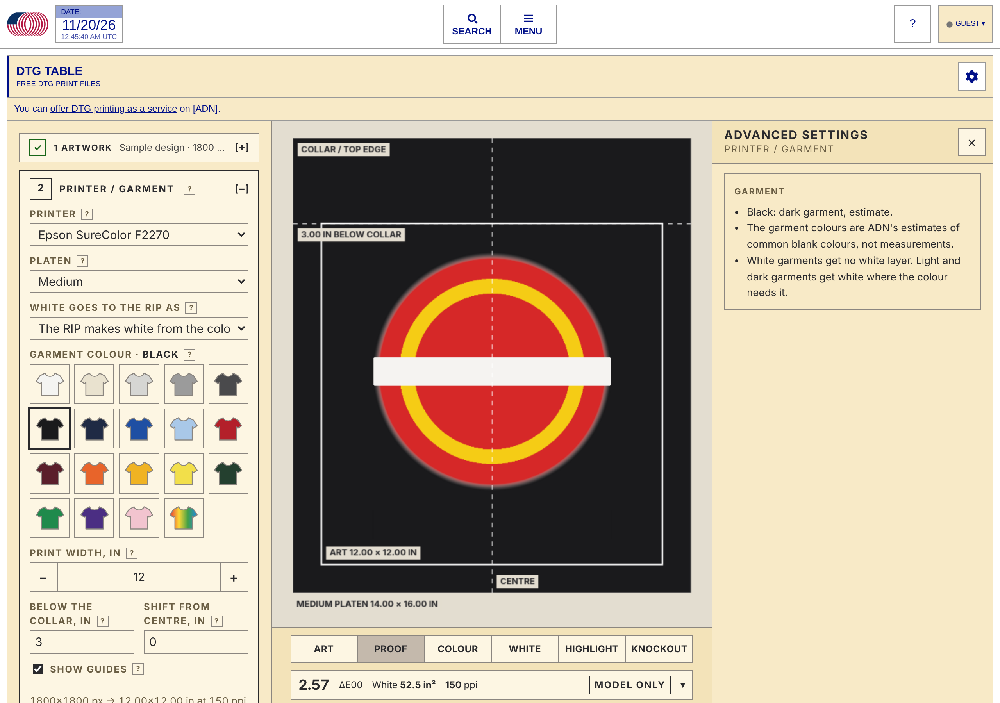

<picture>
  <source media="(prefers-color-scheme: dark)" srcset="src/assets/brand/header-dark.svg">
  
</picture>

# DTG Table

Free, open-source print files for direct-to-garment (DTG) printing.
Runs in your browser.

**[Open DTG Table](https://americandreamnetwork.us/tools/printing/dtg-printing/dtg-table)**
· MIT License · © American Dream Network

Version 0.1.0 · [Changelog](CHANGELOG.md) ·
[Release notes](releases/0.1.0.md)

## What it does

DTG Table prepares print-ready files for your DTG printer's own
software (Epson Garment Creator 2, Brother GTX Graphics Lab, Kornit /
ColorGate, CADlink and others). Drop your art, pick the printer and
the garment, and download a colour layer and white layers, with the
garment colour knocked out and a proof of the print on the shirt. It
never drives a printer and does not replace a RIP. Nothing is
uploaded: the art stays in your browser tab.

<picture>
  <source media="(prefers-color-scheme: dark)" srcset="docs/screenshot-dark.png">
  
</picture>

## Features

### White

- White where the colour needs it, by garment: none on white
  garments, white under the colour on light and dark ones.
- Full white under every colour by default. Least white (the rule
  `reach`), with the colour file lightened to match, once a measured
  white ramp says the saving is real.
- Highlight white under near-white art, white density, and a choke
  in millimetres.

### Knockout

- Where the art is the shirt's own colour (within a ΔE00 tolerance),
  no ink and no white: the shirt prints as itself.

### Printer and garment

- Presets with cited sources: Epson SureColor F2270 and F1070, Brother
  GTXpro, Kornit Atlas MAX Plus, or a custom printer. Anything without
  a source is marked "default, verify".
- 18 common blank colours (estimates), or your own by hex or measured
  L\*a\*b\*.
- Saved machines in the browser.

### Files

- Colour and white files as PNG or TIFF at the art's full resolution,
  with the print resolution in the file.
- Placement on the platen: collar offset, shift from centre, guides,
  and a placement sheet for the operator. Guides never go into the RIP
  files.

### Proof and ramps

- A garment proof with ΔE00 against the art and white in square
  inches (model only).
- Import measured white and colour ramps (`ink,tint,L,a,b` CSV) from
  the test targets.

## Workflows

### Printer software with its own white

1. Drop the art (PNG with transparency, about 300 ppi at print size).
2. Pick the printer, the platen and the garment. Leave "White goes to
   the RIP as" on the RIP making white from the colour file.
3. Download the colour file. Load it in Garment Creator 2, GTX
   Graphics Lab or your RIP. The garment colour is already knocked
   out.

### Printer software that takes a white file

Set "White goes to the RIP as" to "A separate white file", and load the
colour and white files together. Measure the white ramp first (below)
before you use least white.

### Calibrate to your printer

`npm run targets` writes the test targets. Print them, measure them
with a spectrophotometer, and import `readings.csv` in Shop setup
(docs/TARGETS.md).

## Run it locally

Needs Node 22 or newer.

```bash
git clone https://github.com/navruhtra/dtg-table
cd dtg-table
npm run setup   # pinned libraries and the Separation Table engine into src/vendor/
npm start       # http://localhost:8378
```

`npm run setup` downloads quickhull3d and the Separation Table engine
at the pinned commit, and checks each file against
`src/vendor.sha256`.

## Tests and benchmark

```bash
npm test             # unit and property tests
npm run typecheck    # tsc on the files marked @ts-check
npm run benchmark    # benchmark gate against benchmark/baseline.json
npm run setup:e2e    # once: Playwright and its Chromium into .cache/
npm run e2e          # the page in Chromium at 390 × 844 and 1280 × 800
```

| Layer | What it checks |
|---|---|
| `tests/check.mjs` | the white rule, knockout, garment classes, choke and the white layers |
| `tests/presets.mjs` | printer and garment presets, machine profiles, layer files (PNG with pHYs, TIFF), the proof |
| `tests/ramps.mjs` | measured ramps read and fitted, and the white model they make |
| `tests/placement.mjs` | placement on the platen, its warnings and the operator's lines |
| `benchmark/run.mjs --gate` | a fixed referee that simulates the print with its own white model, on 15 test images; exit 2 when a config is worse than the baseline |
| `tests/page.cjs` | every function of the page at a phone and a desktop size, alone and framed as on the ADN site |

CI: `.github/workflows/test.yml` runs setup, the release and notice
checks, the type check, the tests, the benchmark gate and the browser
test on every push to main and every pull request.

## Status

Version 0.1.0. On 2026-11-20 the unit tests, the type check, the
benchmark gate (nothing worse than the baseline) and the browser test
all passed.

Every quality number is a model number. No print of the test targets
has been measured yet.

## More

- [How it works](docs/ENGINE.md): the white rule, compensation, the
  page and the Separation Table engine
- [Benchmark](docs/BENCHMARK.md)
- [How it compares](docs/COMPARISON.md)
- [Test targets](docs/TARGETS.md): what to print and measure
- [Publishing a release](docs/RELEASE.md)
- [Changelog](CHANGELOG.md)

## Known limits

- Every ΔE and white saving is a model number until the test targets
  are printed and measured. The benchmark says least white pays off
  only when the white ramp is measured on the printer; until then full
  white is the safe setting and the default.
- Whether a RIP keeps a white file you send, or makes its own, is not
  checked yet (target D).
- White as a channel inside one TIFF is not written yet; white goes as
  separate files.
- Garment colours are estimates, not measurements of any maker's
  fabric.
- Printer presets are not checked on the machines; fields marked
  "default, verify" are defaults.

## Credits and license

MIT, Copyright (c) 2026 American Dream Network (LICENSE). The ADN
name and logo are not licensed for reuse.

To contribute, read CONTRIBUTING.md.

The colour maths, base rule, chokes and ramp fitting come from the
[Separation Table](https://github.com/navruhtra/separation-table)
engine (MIT, American Dream Network), downloaded at a pinned commit.
Libraries keep their own licenses: THIRD-PARTY-NOTICES.md (generated
from the pins) and NOTICE (what each is for, and the published
methods the tool uses). GPL, AGPL and non-commercial code is left out
on purpose.
